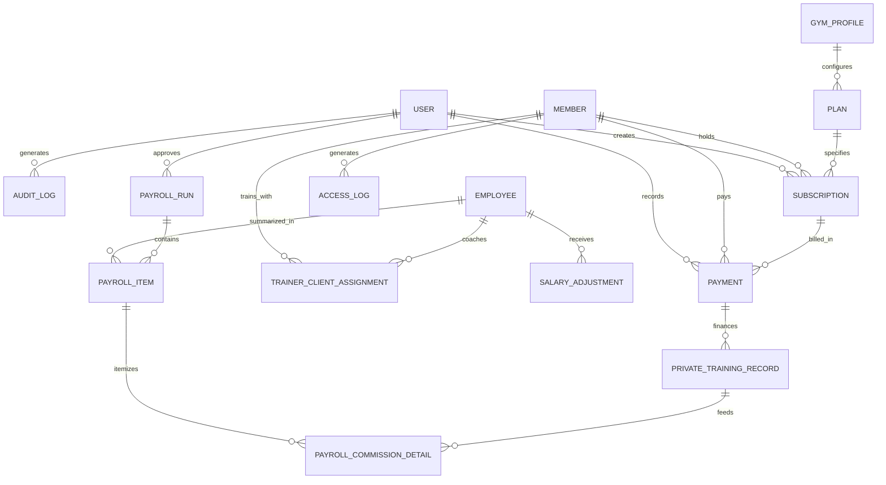

# HULK GYM — Target Relational Data Model Specification

**Document Version:** 1.0.0  
**Target Engine:** PostgreSQL (Production) / SQLite3 (Local Dev & Automated Tests)  
**ORM:** Django ORM with full constraint validation, indices, and decimal precision

---

## 1. Entity Relationship Diagram (Conceptual)

---

## 2. Table Specifications & Field Schemas

### 2.1. Core Gym & Access Control

#### `core_gymprofile` (Gym Settings)
| Field | Type | Attributes | Description |
|---|---|---|---|
| `id` | BigAutoField | PK | Singleton configuration record. |
| `gym_name` | CharField(100) | default='HULK GYM' | Gym trading name. |
| `manager_mobile` | CharField(20) | default='01080922432' | Number receiving daily management reports. |
| `currency` | CharField(10) | default='EGP' | Base currency for receipts and payroll. |
| `timezone` | CharField(50) | default='Africa/Cairo' | Local operational timezone. |
| `daily_report_time` | TimeField | default='01:30' | Scheduled execution time for daily audit report. |
| `esp_ip` | GenericIPAddressField | default='192.168.1.254' | Hardware terminal IP on local gym Wi-Fi. |
| `esp_port` | PositiveIntegerField | default=80 | Hardware terminal HTTP port. |
| `esp_enabled` | BooleanField | default=True | Master toggle for hardware terminal polling/push. |

#### `accounts_user` (Application Staff)
| Field | Type | Attributes | Description |
|---|---|---|---|
| `id` | BigAutoField | PK | Standard Django user. |
| `username` | CharField(150) | Unique | Login identifier. |
| `role` | CharField(20) | Choices: `MANAGER`, `ASSISTANT` | Role governing permissions matrix. |
| `is_active` | BooleanField | default=True | Employment status. |

---

### 2.2. Members, Plans & Subscriptions

#### `members_plan` (Subscription Packages)
| Field | Type | Attributes | Description |
|---|---|---|---|
| `id` | BigAutoField | PK | Identifier. |
| `name` | CharField(100) | Unique | E.g., "شهري شامل - كل يوم", "جلسة واحدة". |
| `price` | DecimalField(10, 2) | Min 0.00 | Standard list price. |
| `duration_days` | PositiveIntegerField | E.g., 28, 14, 1 | Duration added to expiration date. |
| `is_active` | BooleanField | default=True | Soft-delete / archiving of obsolete plans. |

#### `members_member` (Member Profiles)
| Field | Type | Attributes | Description |
|---|---|---|---|
| `id` | BigAutoField | PK | Internal primary key. |
| `member_id` | CharField(30) | Unique, Index | Legacy human ID (`MEM-00001` to `MEM-99999`). |
| `name` | CharField(150) | Index | Member full name. |
| `mobile` | CharField(20) | Index | Normalized mobile phone (e.g. `010XXXXXXXX`). |
| `gender` | CharField(10) | Choices: `male`, `female` | Member gender. |
| `current_status` | CharField(15) | Choices: `active`, `expired` | Current real-time subscription status. |
| `fingerprint_id` | PositiveIntegerField | Nullable, Unique | R307 sensor template slot (1-1000). |
| `last_subscription_start` | DateField | Nullable | Start date of latest subscription. |
| `last_subscription_end` | DateField | Nullable, Index | Expiry date of latest subscription. |
| `current_paid` | DecimalField(10, 2) | default=0.00 | Paid towards current active cycle. |
| `current_remaining` | DecimalField(10, 2) | default=0.00, Index | Outstanding receivables / debt. |
| `total_paid` | DecimalField(10, 2) | default=0.00 | Lifetime payments collected. |
| `google_contact_synced_at` | DateTimeField | Nullable | Timestamp of successful Google People API push. |
| `follow_up_date` | DateField | Nullable | Optional CRM re-engagement date. |
| `notes` | TextField | Blank | Administrative reception notes. |

#### `members_subscription` (Subscription Contract Ledger)
| Field | Type | Attributes | Description |
|---|---|---|---|
| `id` | BigAutoField | PK | Contract ID. |
| `member` | FK(`Member`) | on_delete=PROTECT | Bound member. |
| `plan` | FK(`Plan`) | on_delete=PROTECT | Configured plan package. |
| `start_date` | DateField | Index | Subscription coverage start. |
| `end_date` | DateField | Index | Subscription coverage expiration. |
| `plan_price` | DecimalField(10, 2) | Base price at time of purchase. |
| `discount` | DecimalField(10, 2) | default=0.00 | Applied reduction. |
| `net_amount` | DecimalField(10, 2) | `plan_price - discount`. |
| `paid_amount` | DecimalField(10, 2) | Amount paid upon activation. |
| `remaining_amount` | DecimalField(10, 2) | Debt generated by this contract. |
| `created_at` | DateTimeField | auto_now_add=True | Audit timestamp. |
| `created_by` | FK(`User`) | on_delete=SET_NULL | Staff member who authorized the plan. |

---

### 2.3. Payments & Expenses

#### `payments_payment` (Financial Transactions)
| Field | Type | Attributes | Description |
|---|---|---|---|
| `id` | BigAutoField | PK | Transaction ID. |
| `payment_id` | CharField(30) | Unique, Index | Legacy ID (`PAY-00001`). |
| `invoice_no` | CharField(30) | Unique, Index | Invoice number (`INV-00001`). |
| `operation_type` | CharField(25) | Choices: `new_subscription`, `renewal`, `remaining` | Transaction category. |
| `member` | FK(`Member`) | on_delete=PROTECT | Payer. |
| `subscription` | FK(`Subscription`)| Nullable, on_delete=SET_NULL | Linked subscription contract. |
| `amount` | DecimalField(10, 2) | Min 0.01 | Cash collected. |
| `payment_method` | CharField(30) | Choices: `نقدي`, `انستاباي`, `فودافون كاش`, `تحويل بنكي`, `بطاقة بنكية` | Instrument used. |
| `created_at` | DateTimeField | auto_now_add=True, Index | Payment timestamp. |
| `created_by` | FK(`User`) | on_delete=SET_NULL | Cashier / receptionist. |

#### `expenses_expense` (Operational Overhead)
| Field | Type | Attributes | Description |
|---|---|---|---|
| `id` | BigAutoField | PK | Identifier. |
| `amount` | DecimalField(10, 2) | Min 0.01 | Expense sum. |
| `category` | CharField(50) | Index | E.g. "إيجار", "فاتورة كهرباء", "صيانة", "معدات", "مستلزمات". |
| `description` | TextField | Blank | Details / receipts reference. |
| `expense_date` | DateField | Index | Accrual date. |
| `created_at` | DateTimeField | auto_now_add=True | Entry timestamp. |
| `created_by` | FK(`User`) | on_delete=SET_NULL | Recorded user. |

---

### 2.4. Trainer Management & Payroll (New Subsystem)

#### `payroll_employee` (Gym Staff & Trainers)
| Field | Type | Attributes | Description |
|---|---|---|---|
| `id` | BigAutoField | PK | Employee ID. |
| `name` | CharField(150) | Employee full name. |
| `mobile` | CharField(20) | Contact & WhatsApp notification number. |
| `role` | CharField(20) | Choices: `TRAINER`, `ASSISTANT`, `MANAGER` | Employment role. |
| `status` | CharField(15) | Choices: `ACTIVE`, `INACTIVE` | Employment status. |
| `fixed_salary` | DecimalField(10, 2) | default=0.00 | Monthly base salary. |
| `hire_date` | DateField | Nullable | Start of employment. |
| `notes` | TextField | Blank | Private personnel notes. |

#### `payroll_trainerclientassignment` (Private Coaching Contracts)
| Field | Type | Attributes | Description |
|---|---|---|---|
| `id` | BigAutoField | PK | Assignment ID. |
| `trainer` | FK(`Employee`) | on_delete=PROTECT | Assigned coach. |
| `client` | FK(`Member`) | on_delete=PROTECT | Private coaching athlete. |
| `commission_rate`| DecimalField(5, 4) | Range 0.0000 - 1.0000 | E.g., `0.5000` for 50%. |
| `effective_from` | DateField | Index | Start of agreement. |
| `effective_to` | DateField | Nullable | Expiration / rate amendment cutoff. |
| `is_active` | BooleanField | default=True | Active flag. |

#### `payroll_privatetrainingrecord` (Itemized Private Training Billing)
| Field | Type | Attributes | Description |
|---|---|---|---|
| `id` | BigAutoField | PK | Record ID. |
| `payment` | OneToOneField(`Payment`) | on_delete=PROTECT | Financial payment funding this session. |
| `trainer` | FK(`Employee`) | on_delete=PROTECT | Coach entitled to commission. |
| `client` | FK(`Member`) | on_delete=PROTECT | Coached athlete. |
| `package_price` | DecimalField(10, 2) | Total charged for package. |
| `standard_plan_price` | DecimalField(10, 2) | Price of base gym access. |
| `private_markup`| DecimalField(10, 2) | `package_price - standard_plan_price`. |
| `commission_rate` | DecimalField(5, 4) | Rate frozen at transaction time. |
| `calculated_commission`| DecimalField(10, 2) | `private_markup * commission_rate`. |
| `is_counted_in_payroll`| BooleanField | default=False | Prevents double-counting across payroll runs. |

#### `payroll_salaryadjustment` (Bonuses & Deductions)
| Field | Type | Attributes | Description |
|---|---|---|---|
| `id` | BigAutoField | PK | Adjustment ID. |
| `employee` | FK(`Employee`) | on_delete=PROTECT | Beneficiary or penalized staff. |
| `period` | CharField(7) | Regex `^\d{4}-\d{2}$` (YYYY-MM) | Target payroll cycle. |
| `adjustment_type`| CharField(15) | Choices: `BONUS`, `DEDUCTION` | Direction of adjustment. |
| `category` | CharField(50) | E.g., "أداء", "حضور", "غياب", "تأخير", "سلفة". |
| `amount` | DecimalField(10, 2) | Min 0.01 | Adjustment value. |
| `reason` | TextField | Detailed mandatory justification. |
| `status` | CharField(20) | Choices: `DRAFT`, `PENDING_APPROVAL`, `APPROVED`, `REJECTED` | Approval state machine. |
| `created_by` | FK(`User`) | on_delete=PROTECT | Proposer. |
| `approved_by` | FK(`User`) | Nullable, on_delete=SET_NULL | Manager who approved. |
| `approved_at` | DateTimeField | Nullable | Approval audit timestamp. |

#### `payroll_payrollrun` (Monthly Closed Payroll Cycle)
| Field | Type | Attributes | Description |
|---|---|---|---|
| `id` | BigAutoField | PK | Run ID. |
| `period` | CharField(7) | Unique, Index (`YYYY-MM`) | Payroll calendar month. |
| `status` | CharField(20) | Choices: `DRAFT`, `CALCULATED`, `UNDER_REVIEW`, `APPROVED`, `PAID` | Payroll state. |
| `total_fixed_salary`| DecimalField(10, 2)| Sum of all base salaries. |
| `total_commissions` | DecimalField(10, 2)| Sum of all eligible private commissions. |
| `total_bonuses` | DecimalField(10, 2)| Sum of approved incentives. |
| `total_deductions` | DecimalField(10, 2)| Sum of approved penalties. |
| `net_payable` | DecimalField(10, 2)| Final payout obligation. |
| `approved_by` | FK(`User`) | Nullable, on_delete=PROTECT | Authorizing manager. |
| `approved_at` | DateTimeField | Nullable | Immutable sealing timestamp. |

#### `payroll_payrollitem` (Employee Immutable Salary Snapshot)
| Field | Type | Attributes | Description |
|---|---|---|---|
| `id` | BigAutoField | PK | Item ID. |
| `payroll_run` | FK(`PayrollRun`) | on_delete=CASCADE | Parent run. |
| `employee` | FK(`Employee`) | on_delete=PROTECT | Staff recipient. |
| `fixed_salary` | DecimalField(10, 2)| Snapshot base salary. |
| `commissions` | DecimalField(10, 2)| Total private coaching payout. |
| `bonuses` | DecimalField(10, 2)| Total approved bonuses. |
| `deductions` | DecimalField(10, 2)| Total approved deductions. |
| `net_payable` | DecimalField(10, 2)| Final individual salary. |
| `whatsapp_sent_at` | DateTimeField | Nullable | Confirmation of statement delivery. |
| `is_paid` | BooleanField | default=False | Cash disbursement flag. |

---

### 2.5. Messaging & Integration Support

#### `messaging_whatsappmessage` (Outbox Queue)
| Field | Type | Attributes | Description |
|---|---|---|---|
| `id` | BigAutoField | PK | Message ID. |
| `mobile` | CharField(20) | Index | Recipient number. |
| `message` | TextField | Full body with resolved placeholders. |
| `msg_type` | CharField(30) | Choices: `receipt`, `reminder_3`, `reminder_1`, `expired`, `salary_statement`, `manager_report` | Message category. |
| `status` | CharField(20) | Choices: `pending`, `scheduled`, `sent`, `failed` | Delivery queue state. |
| `send_after` | DateTimeField | Nullable, Index | Delayed dispatch threshold. |
| `sent_at` | DateTimeField | Nullable | Successful transmission time. |
| `dedup_key` | CharField(100) | Unique, Index | Prevents spam / duplicate sends. |
| `error_detail` | TextField | Blank | Failure diagnostic info. |
