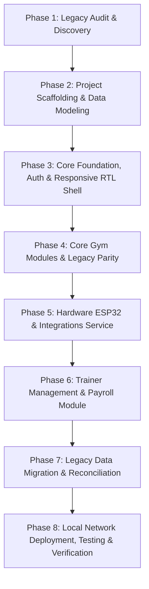

# HULK GYM — Phased Web Implementation Plan

**Document Version:** 1.0.0  
**Effective Date:** 2026-10-10  
**Guiding Philosophy:** Correctness & Data Safety → Feature Parity → Usability → Visual Polish

---

## Roadmap Overview

---

## Detailed Implementation Phases

### Phase 1: Audit & Architectural Specification (Completed)
- **Deliverables:**
  - `docs/LEGACY_SYSTEM_AUDIT.md`
  - `docs/FEATURE_PARITY_MATRIX.md`
  - `docs/BUSINESS_RULES.md`
  - `docs/DATA_MODEL.md`
  - `docs/INTEGRATION_CONTRACTS.md`
  - `docs/SECURITY_AND_MIGRATION.md`
  - `docs/WEB_IMPLEMENTATION_PLAN.md`
- **Verification Gate:** Thorough review of existing codebase, data files, and firmware contracts.

---

### Phase 2: Project Scaffolding & Relational Models
- **Directory Structure:** Create clean `web/` Django project structure:
  - `config/` (settings, urls, wsgi, asgi)
  - `apps/accounts/` (User, Role, Auth)
  - `apps/core/` (GymProfile, Settings, Base Views)
  - `apps/members/` (Member, Plan, Subscription)
  - `apps/payments/` (Payment, Invoice generation)
  - `apps/expenses/` (Expense, Categories)
  - `apps/fingerprint/` (ESP32 client, Sync, Access logs)
  - `apps/messaging/` (WhatsApp queue, Templates)
  - `apps/payroll/` (Employee, Trainer assignments, Adjustments, Payroll runs)
  - `apps/reports/` (Financial reports, Exports)
- **Configuration:** Setup SQLite for development/tests, PostgreSQL ready for production, decimal precision, timezone `Africa/Cairo`, Arabic language defaults.
- **Verification Gate:** `python manage.py makemigrations && python manage.py migrate` passes cleanly.

---

### Phase 3: Core Foundation, Roles & Responsive UI Shell
- **Authentication & RBAC:**
  - Login view with Manager and Assistant role assignment.
  - Role-based template tags and server-side view decorators (`@manager_required`, `@assistant_required`).
- **Responsive RTL UI Framework:**
  - Mobile-first, touch-friendly UI using semantic HTML5, CSS Grid/Flexbox, and HTMX.
  - Gym dark aesthetic: Background `#050B10`, Card Surface `#0c1720`, Accent Gold `#FFB300`, Danger `#E53935`, Success `#00C853`.
  - Mobile bottom navigation bar + Desktop sidebar navigation.
  - Large touch targets (min 48px height) for tablet/phone reception use.
- **Verification Gate:** Responsive test suite verifying layout at 375px (iPhone), 768px (iPad), and 1440px (Desktop).

---

### Phase 4: Core Gym Modules & Legacy Parity
- **Member Management:**
  - Unified reception check-in page with HTMX instant search and candidate disambiguation.
  - Member creation, editing, profile cards, subscription timeline.
- **Subscriptions & Billing:**
  - Package selection, duration calculation (28/14/1 days), date chaining.
  - Partial payments, outstanding receivables tracking.
  - Receipt generation and printable view.
- **Expenses & Manager Reports:**
  - Expense logging with categories.
  - Revenue vs. expense statement, net profit, cash-drawer reconciliation.
- **Verification Gate:** Automated unit tests covering subscription date math, partial payments, and financial calculations.

---

### Phase 5: Hardware ESP32 & External Integrations
- **ESP32 Service Module:**
  - Port `v1/esp_client.py` logic to standard Django service.
  - Root endpoints: `/status`, `/members`, `/enroll`, `/cancel_enroll`, `/fingerprint`, `/last_scan`.
  - Background task for non-blocking enrollment (90s timeout).
  - Minimal payload enforcement (no personal data transmitted).
- **WhatsApp Outbox Service:**
  - Queue management, anti-ban rate limiter (20/min, 120/hr).
  - Background dispatcher with Windows host execution option.
- **Google Contacts Sync Worker:**
  - Background OAuth sync with 1-hour delay staging for un-synced phone receipts.
- **Verification Gate:** 100% of ESP32 contract tests passing (`test_esp_client_contract.py`).

---

### Phase 6: Trainer Management & Payroll Module
- **Employee Profiles:**
  - Staff directory, role-based compensation models (Fixed salary).
- **Private Coaching Subsystem:**
  - Trainer-client assignment with configurable commission rates.
  - Private training packages billing:
    $$\text{Private Markup} = \text{Package Price} - \text{Standard Plan Price}$$
    $$\text{Commission} = \text{Private Markup} \times \text{Trainer Rate}$$
- **Adjustments Workflow:**
  - Bonus and deduction creation (Draft -> Pending -> Approved -> Rejected).
  - Manager approval gate (creators cannot approve own adjustments).
- **Payroll Execution & Statements:**
  - Monthly payroll calculation engine.
  - Review screen with detailed breakdown per employee and per client.
  - Approval action creating sealed, immutable snapshot.
  - Individual salary statement generation (Printable HTML/CSS + WhatsApp dispatch).
- **Verification Gate:** Unit tests covering all 10 user-specified scenarios (A through J).

---

### Phase 7: Data Migration & Reconciliation
- **Migration Command:** `python manage.py migrate_legacy_data --source=v1/data`
- **Reconciliation Engine:**
  - Verifies 231 members migrated.
  - Verifies 84 payments and exact revenue totals match.
  - Verifies 8 fingerprint template IDs preserved.
- **Verification Gate:** Automatic reconciliation assertion passes with zero discrepancies.

---

### Phase 8: Local Network Deployment & Documentation
- **Local Server Hosting:**
  - Guide to running Daphne / Gunicorn / Waitress on the gym host PC bound to `0.0.0.0:8000`.
  - Configuration of Windows Firewall to allow incoming LAN traffic on port 8000.
  - Static local IP configuration for the host computer (`192.168.1.100`) and the ESP32 (`192.168.1.254`).
- **One-Click Startup Scripts:**
  - Windows batch script (`start_hulk_web.bat`) for easy desktop startup by gym staff.
- **Backup & Recovery:**
  - Automated daily database backup script to a secure local folder.
- **Verification Gate:** Manual verification from a physical mobile phone and tablet connected to the local gym Wi-Fi.
